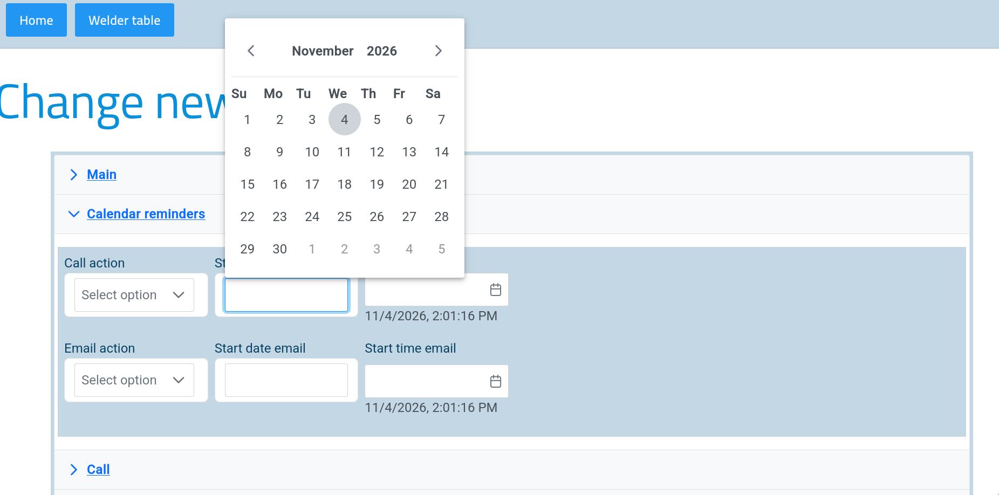
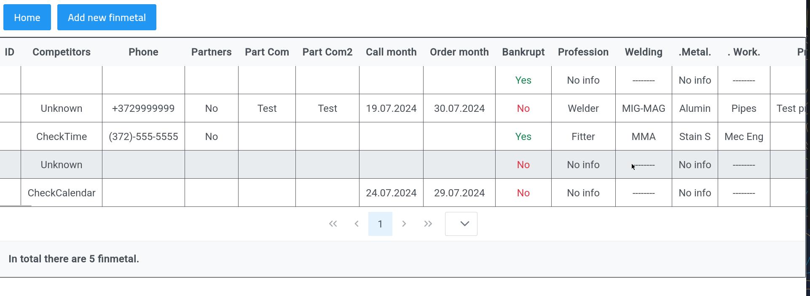

# Angular CRM

A small Customer Relationship Management (CRM) web app built with **Angular 18** while I was learning the framework during my internship. It lets a user add and browse two kinds of records:

- **Welders** – candidate records (contact details, desired job category and position, availability, call/email history, salary expectations, documents and comments).

- **FinMetal** – company / partner records (contact info, competitor, partner availability, profession description, comments).


The back end is simulated with [json-server](https://github.com/typicode/json-server), so the app works with a real REST API (GET and POST) without needing a full server.

## Features

- Navigation menu with routing between all pages
- Two large data-entry forms: **32 fields** (welder) and **244 fields** (FinMetal), built with Angular **Reactive Forms** (validation for required fields, e-mail format and max length, input masks, date pickers, dropdowns, switches)
- Welder and FinMetal tables with pagination and row selection (PrimeNG Table)
- Data is loaded and saved through a REST API using Angular `HttpClient` and `fetch`
- Standalone components, services and typed interfaces

## Tech stack

| Area | Tools |
|------|-------|
| Framework | Angular 18 (standalone components, Angular Router, Reactive Forms) |
| Language | TypeScript, HTML, CSS/SCSS |
| UI | PrimeNG, PrimeFlex, Bootstrap, Angular Material, Ignite UI |
| Mock back end | json-server (`db.json`) |
| Tests | Karma + Jasmine |

## Getting started

### Prerequisites

- [Node.js](https://nodejs.org/) 18.19+ or 20.11+ (and npm)

### Install and run

```bash
# 1. Clone the repository and install dependencies
git clone git@github.com:maona-creative/angular-crm.git
cd angular-crm
npm install

# 2. Terminal 1 – start the mock REST API on http://localhost:3000
npx json-server db.json

# 3. Terminal 2 – start the Angular app on http://localhost:4200
npm start
```

Open <http://localhost:4200>. The API must be running, otherwise the tables will be empty and the forms cannot save.

| Page | URL |
|------|-----|
| Navigator (home) | `/navigator` |
| Welder table | `/welder-table` |
| Add new welder | `/welder-forms` |
| FinMetal table | `/finmetal-table` |
| Add new FinMetal | `/finmetal-forms` |

API endpoints: `http://localhost:3000/welders` and `http://localhost:3000/finmetals`. New records are saved into `db.json`.

> **Note:** the repository includes an `.npmrc` with `legacy-peer-deps=true`, because some UI libraries still declare Angular 17 as a peer dependency.

## Project structure

```
src/app/
├── navigator/        # top menu
├── welderforms/      # add-welder form + service
├── weldertable/      # welder table
├── finmetalforms/    # add-FinMetal form + service
├── finmetaltable/    # FinMetal table + service
└── app.routes.ts     # routing
db.json               # mock database for json-server
```

## Other commands

```bash
npm run build   # production build
npm test        # unit tests (Karma + Jasmine)
```

## What I learned

- Structuring an Angular app with standalone components, routing and services
- Building large forms with Reactive Forms and validation
- Working with a REST API (GET / POST) and a mock back end
- Using a component library (PrimeNG) for tables and form controls
